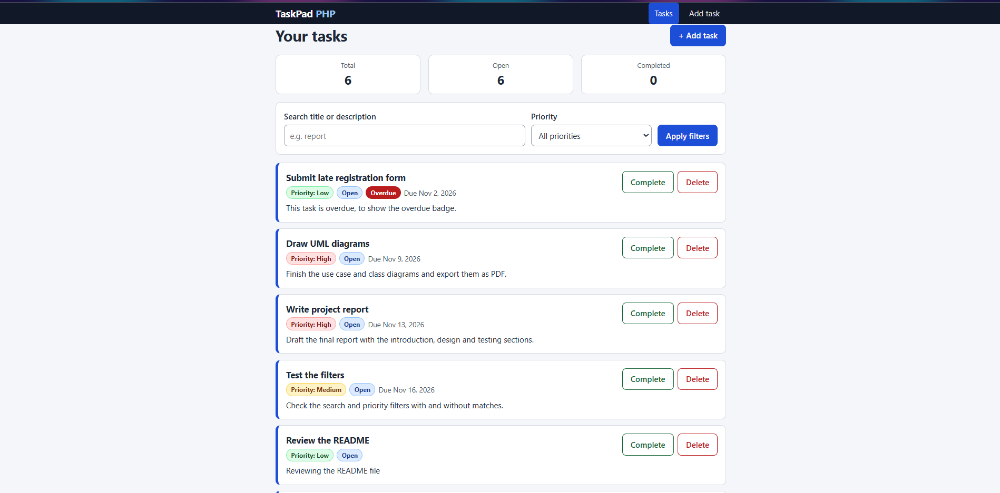

# TaskPad PHP

A small task tracker built with plain PHP: no framework and no database. Add tasks, search and filter them, mark them complete or delete them. Everything is saved in a flat JSON file on the server.

**Group members:** Mohamed Alarbah and Mohamed Abdulla



## Contents
1. [Quick start](#quick-start)
2. [Features](#features)
3. [How it works](#how-it-works)
4. [Validation rules](#validation-rules)
5. [Security](#security)
6. [Testing](#testing)
7. [Screenshots](#screenshots)
8. [UML diagrams](#uml-diagrams)
9. [Project structure](#project-structure)
10. [Assignment checklist](#assignment-checklist)
11. [Team contributions](#team-contributions)
12. [Limitations](#limitations)

## Quick start

**Requirements:** PHP 7.4 or newer (no other software needed). Check with `php -v`.
Tested on PHP 8.3 and PHP 8.5.

```
php -S localhost:8000 -t public
```

Then open <http://localhost:8000> in your browser.

| Want to... | Run |
|---|---|
| Add sample tasks for a quick look | `php tests/seed_sample_data.php` |
| Run the automated checks | `php tests/run_tests.php` |
| Start again with an empty list | Delete `data/tasks.json` (Windows: `del data\tasks.json`) |

All commands run from the project folder. `data/tasks.json` is created automatically the first time a task is saved.

**Troubleshooting**
- *`php` is not recognized:* PHP is not on your PATH. Reopen the terminal after installing it.
- *Port already in use:* start the server on another port, for example `php -S localhost:8001 -t public`.

## Features

| Area | What it does |
|---|---|
| **Create a task** | Title (required), description, priority (Low / Medium / High) and due date (optional) |
| **List and filter** | Search title and description (case-insensitive) with `?q=report` and filter by priority with `?priority=High`, or combine both |
| **Counts and states** | Total, open and completed counts; priority, status and overdue badges; empty state and "no matching tasks" state |
| **Complete / Delete** | POST buttons on each task, then a redirect back to the list with a success message. Delete asks for confirmation |
| **Friendly errors** | Problems are shown next to the field and the user's entries are kept |
| **JSON view** | `export.php` shows the tasks (and respects the same filters) as JSON |

## How it works

| URL | Method | Purpose |
|---|---|---|
| `index.php` | GET | List, filter, counts, flash messages |
| `create.php` | GET / POST | Show the form / validate and save |
| `actions.php` | POST only | Mark complete or delete (a GET request gets HTTP 405) |
| `export.php` | GET | JSON view of the tasks |

**Post/Redirect/Get.** After a successful save, the server answers with a redirect (HTTP 303) to the list, so refreshing the page never submits the form twice:

```
Browser                         Server
  |  POST create.php  ------->   validate and sanitize
  |                              save to data/tasks.json
  |  <------ 303 Location: index.php
  |  GET index.php    ------->   list page + one-time success message
```

If validation fails, the form is shown again with HTTP 422, the error messages and the user's entries.

Each task is stored as:

```json
{
  "id": "3f2b8c1e-5d9a-4b7e-9c1a-2e6f0d8a4b11",
  "title": "Write report",
  "description": "Final draft",
  "priority": "High",
  "due": "2026-12-31",
  "completed": false,
  "created": "2026-11-05T10:15:00+00:00"
}
```

`created` is an extra field used to order tasks. Open tasks are listed first, then by due date.

## Validation rules

| Field | Rule |
|---|---|
| Title | Required, up to 100 characters, extra spaces trimmed |
| Description | Optional, up to 500 characters |
| Priority | Must be Low, Medium or High (whitelist); defaults to Medium |
| Due date | Optional; must match `YYYY-MM-DD` and be a real date (`checkdate`) |
| Search `q` | Trimmed, up to 100 characters; arrays and invalid text are ignored |
| Filter `priority` | Must be Low, Medium or High; anything else is ignored |
| Task id | Must look like a UUID before any action is taken |

## Security

- Inputs are read from `$_POST` and `$_GET`, then trimmed, length-checked and validated on the server.
- All user text is escaped with `htmlspecialchars` before it is shown (XSS protection).
- Anything that changes data uses POST; GET requests to `actions.php` are rejected.
- Every POST form has a CSRF token that is checked on the server.
- Redirects after actions are rebuilt from whitelisted values, so they cannot point to another site.
- Saving uses file locking, so two requests cannot corrupt `tasks.json`.
- Content types are set explicitly: `text/html; charset=UTF-8` and `application/json`.
- Responses include `X-Content-Type-Options`, `X-Frame-Options` and `Referrer-Policy` headers.

## Testing

- **Automated:** `php tests/run_tests.php` runs 29 checks covering validation, saving and loading, filtering, counts and a corrupted data file. All pass.
- **Manual:** the steps in [`docs/testing-checklist.md`](docs/testing-checklist.md) cover each feature, the error and empty states, and the layout at mobile, tablet and desktop widths.

## Screenshots

All screenshots are in [`docs/screenshots/`](docs/screenshots/) (file list in its [README](docs/screenshots/README.md)).

| State | Desktop | Tablet | Mobile |
|---|---|---|---|
| Create form: error | [view](docs/screenshots/create-error-desktop.png) | [view](docs/screenshots/create-error-tablet.png) | [view](docs/screenshots/create-error-mobile.png) |
| Create form: success | [view](docs/screenshots/create-success-desktop.png) | [view](docs/screenshots/create-success-tablet.png) | [view](docs/screenshots/create-success-mobile.png) |
| List without filters | [view](docs/screenshots/list-nofilter-desktop.png) | [view](docs/screenshots/list-nofilter-tablet.png) | [view](docs/screenshots/list-nofilter-mobile.png) |
| List with filters | [view](docs/screenshots/list-filtered-desktop.png) | [view](docs/screenshots/list-filtered-tablet.png) | [view](docs/screenshots/list-filtered-mobile.png) |
| Complete: before | [view](docs/screenshots/complete-before-desktop.png) | [view](docs/screenshots/complete-before-tablet.png) | [view](docs/screenshots/complete-before-mobile.png) |
| Complete: after | [view](docs/screenshots/complete-after-desktop.png) | [view](docs/screenshots/complete-after-tablet.png) | [view](docs/screenshots/complete-after-mobile.png) |
| Delete: before | [view](docs/screenshots/delete-before-desktop.png) | [view](docs/screenshots/delete-before-tablet.png) | [view](docs/screenshots/delete-before-mobile.png) |
| Delete: after | [view](docs/screenshots/delete-after-desktop.png) | [view](docs/screenshots/delete-after-tablet.png) | [view](docs/screenshots/delete-after-mobile.png) |

## UML diagrams

| Diagram | PDF | PlantUML source |
|---|---|---|
| Use Case | [`docs/uml-usecase.pdf`](docs/uml-usecase.pdf) | [`docs/uml/usecase.puml`](docs/uml/usecase.puml) |
| Class (analysis level) | [`docs/uml-class.pdf`](docs/uml-class.pdf) | [`docs/uml/class.puml`](docs/uml/class.puml) |
| Activity (create a task) | [`docs/uml-activity.pdf`](docs/uml-activity.pdf) | [`docs/uml/activity.puml`](docs/uml/activity.puml) |

To regenerate a diagram, paste its `.puml` text into <https://www.plantuml.com/plantuml> and export it as PDF.

## Project structure

```
taskpad-php/
  public/               web root (the only folder the server exposes)
    index.php           list, filter, counts, flash messages
    create.php          form (GET) and handler (POST)
    actions.php         complete / delete (POST only)
    export.php          JSON view
    assets/style.css    responsive, accessible styles
  src/
    storage.php         Task and TaskRepository (JSON load/save, filter, counts)
    validation.php      Validator (trim, length, whitelist, date check)
    csrf.php            CSRF token create / verify
    flash.php           one-time session messages
    helpers.php         escaping, redirect, URL helpers
    layout.php          shared page header and footer
    bootstrap.php       session, security headers, includes
  data/                 tasks.json is created here
  docs/                 UML, screenshots, group evaluation, testing checklist
  tests/                run_tests.php, seed_sample_data.php
```

## Assignment checklist

| Requirement | Where |
|---|---|
| Create task with validation, inline errors and kept inputs | `public/create.php`, `src/validation.php` |
| Post/Redirect/Get after saving | `public/create.php` (HTTP 303) |
| List, text and priority filters, counts, empty states | `public/index.php`, `src/storage.php` |
| Complete and delete via POST with a flash message | `public/actions.php`, `src/flash.php` |
| JSON persistence in `/data/tasks.json` | `src/storage.php` |
| UML: Use Case, Class (and Activity) | `docs/uml-*.pdf`, `docs/uml/*.puml` |
| Screenshots: desktop, tablet, mobile | `docs/screenshots/` |
| Group evaluation | [`docs/GroupEval.docx`](docs/GroupEval.docx) |
| Manual testing checklist | [`docs/testing-checklist.md`](docs/testing-checklist.md) |

## Team contributions

| Member | Work |
|---|---|
| Mohamed Alarbah | VS Code and PHP setup; adding tasks to test the app; laptop (desktop) and tablet screenshots |
| Mohamed Abdulla | Hosting and GitHub repository setup; uploading the files; creating the files required for the assignment; mobile screenshots; downloading the zipped repository to test a fresh copy |

## Limitations

- Tasks are stored in one JSON file shared by all visitors. There are no user accounts, and it is meant for small, single-user use.
- Dates, such as the "Overdue" badge, are compared with the server's date.
- A deleted task cannot be recovered.
